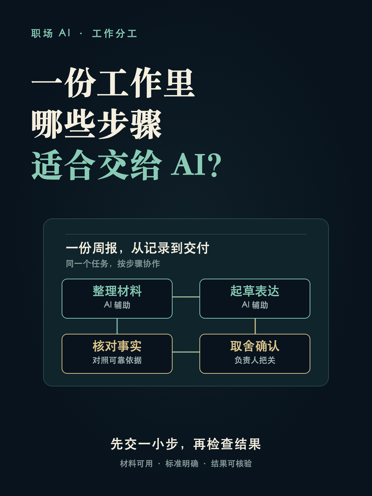
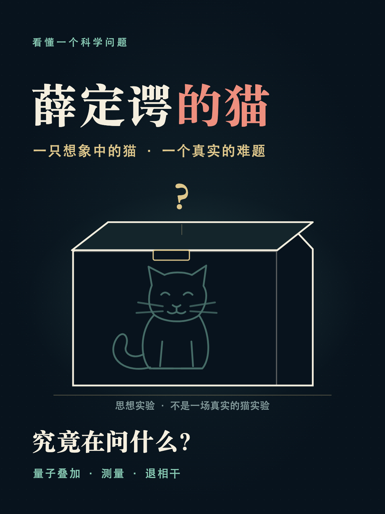

# 知识科普视频导演 · knowledge-video

把一个值得追问的问题，做成观众看得懂、记得住、能核对依据的科普短片。

这是一个可复用的中文 Agent Skill：从资料核查、字幕分镜，到 Remotion 图解动效、音乐音效、MP4 验收、封面与发布文案，覆盖一部知识短片的完整制作流程。

[查看 Skill](SKILL.md) · [下载 Skill 安装包](https://github.com/liunianlh/knowledge-video/releases/download/v1.0.0/knowledge-video.zip) · [全部视频文件](https://github.com/liunianlh/knowledge-video/releases/tag/v1.0.0)

## 已完成的视频案例

以下为此前实际制作并已导出的 9 部成片，覆盖 AI、科学、心理、历史与孕产主题。每个主题选用当前已有的最新成片；点击封面或“下载 MP4”获取完整视频。视频存放在 Releases，安装 Skill 无需下载这些成片。

<table>
<tr>
<td width="33%" valign="top" align="center">
<a href="https://github.com/liunianlh/knowledge-video/releases/download/v1.0.0/ai-workflow.mp4"></a><br>
<strong>一份工作里，哪些步骤适合交给 AI？</strong><br>
1920 × 1080 · 30 FPS · 2:42 · V1<br>
<p>用周报工作流拆解整理、起草、核对与取舍，说明 AI 辅助与人工确认如何分工。</p>
<a href="https://github.com/liunianlh/knowledge-video/releases/download/v1.0.0/ai-workflow.mp4">下载 MP4</a>
</td>
<td width="33%" valign="top" align="center">
<a href="https://github.com/liunianlh/knowledge-video/releases/download/v1.0.0/schrodinger-cat.mp4"></a><br>
<strong>薛定谔的猫，究竟在问什么？</strong><br>
1920 × 1080 · 30 FPS · 2:30 · V1<br>
<p>从箱子里的思想实验讲起，用图解说明量子叠加、测量与退相干的解释边界。</p>
<a href="https://github.com/liunianlh/knowledge-video/releases/download/v1.0.0/schrodinger-cat.mp4">下载 MP4</a>
</td>
<td width="33%" valign="top" align="center">
<a href="https://github.com/liunianlh/knowledge-video/releases/download/v1.0.0/speechless.mp4"></a><br>
<strong>吵架时说不出话，为什么过后才反应过来？</strong><br>
1920 × 1080 · 30 FPS · 2:20 · V1<br>
<p>围绕压力、语言组织和事后思考空间，解释争执时卡壳的一种可能机制。</p>
<a href="https://github.com/liunianlh/knowledge-video/releases/download/v1.0.0/speechless.mp4">下载 MP4</a>
</td>
</tr>
<tr>
<td width="33%" valign="top" align="center">
<a href="https://github.com/liunianlh/knowledge-video/releases/download/v1.0.0/anticipation.mp4"></a><br>
<strong>为什么等了很久的那一天，反而没那么开心？</strong><br>
1920 × 1080 · 30 FPS · 1:42 · V1<br>
<p>用期待与现实的对照，解释被忽略的日常、逐渐发生的适应与快乐评判压力。</p>
<a href="https://github.com/liunianlh/knowledge-video/releases/download/v1.0.0/anticipation.mp4">下载 MP4</a>
</td>
<td width="33%" valign="top" align="center">
<a href="https://github.com/liunianlh/knowledge-video/releases/download/v1.0.0/after-anger.mp4"></a><br>
<strong>为什么发完脾气，才想起好好说话？</strong><br>
1920 × 1080 · 30 FPS · 2:08 · V2<br>
<p>用同一组人物与对话贯穿首尾，把情绪变化、暂停与重新表达做成可见的图解。</p>
<a href="https://github.com/liunianlh/knowledge-video/releases/download/v1.0.0/after-anger.mp4">下载 MP4</a>
</td>
<td width="33%" valign="top" align="center">
<a href="https://github.com/liunianlh/knowledge-video/releases/download/v1.0.0/rumination.mp4"></a><br>
<strong>为什么别人的一句话，能让你反复想一整天？</strong><br>
1920 × 1080 · 30 FPS · 1:45 · V2 动效音效增强<br>
<p>用回声、循环轨道和分层卡片呈现反刍思维，区分原话、推测与具体行动。</p>
<a href="https://github.com/liunianlh/knowledge-video/releases/download/v1.0.0/rumination.mp4">下载 MP4</a>
</td>
</tr>
<tr>
<td width="33%" valign="top" align="center">
<a href="https://github.com/liunianlh/knowledge-video/releases/download/v1.0.0/zhang-qian.mp4"></a><br>
<strong>张骞出使十三年，为什么归来仍被授官？</strong><br>
1080 × 1440 · 30 FPS · 2:24 · V1<br>
<p>用路线、时间刻度和史料卡片梳理出使经历，区分第一次归汉授官与后来的封侯。</p>
<a href="https://github.com/liunianlh/knowledge-video/releases/download/v1.0.0/zhang-qian.mp4">下载 MP4</a>
</td>
<td width="33%" valign="top" align="center">
<a href="https://github.com/liunianlh/knowledge-video/releases/download/v1.0.0/zheng-he.mp4"></a><br>
<strong>郑和下西洋，究竟走了多远？</strong><br>
1080 × 1440 · 30 FPS · 2:42 · V1<br>
<p>在真实海岸线示意图上展开七次远航的合并航迹，说明港口、船队与距离的叙述边界。</p>
<a href="https://github.com/liunianlh/knowledge-video/releases/download/v1.0.0/zheng-he.mp4">下载 MP4</a>
</td>
<td width="33%" valign="top" align="center">
<a href="https://github.com/liunianlh/knowledge-video/releases/download/v1.0.0/pregnancy-tightening.mp4"></a><br>
<strong>肚子一阵阵发紧，是不是快生了？</strong><br>
1080 × 1440 · 30 FPS · 2:16 · 温暖版<br>
<p>以温暖人物场景说明常见宫缩线索、需要联系产科的信号与记录方法，保留就医评估边界。</p>
<a href="https://github.com/liunianlh/knowledge-video/releases/download/v1.0.0/pregnancy-tightening.mp4">下载 MP4</a>
</td>
</tr>
</table>

案例参数来自本次对最终 MP4 的 ffprobe 回读；详细时长、文件大小与 SHA-256 见 [案例清单](examples/catalog.json)。多数案例沿用深蓝细线图解，孕产案例展示按受众调整为温暖视觉的做法；画幅、片长和音乐均按具体任务确定。

## 这个 Skill 会做什么

- **先核实，再讲述**：建立“说法—来源—适用范围—字幕—视觉边界”的证据表，区分研究、推断、教学示例与视觉比喻。
- **让图解承担解释**：字幕推进论证，路径、分层、数量比较和状态变化呈现机制；全片维持统一视觉，并在结尾回答开场问题。
- **统一画面与声音时间线**：字幕、场景边界、动作与声音事件共享时间数据；音乐组织章节，音效对应实际动作。
- **按成片交付并验收**：交付可编辑工程、MP4、字幕、内容依据、3:4 封面、发布文案和检查记录，回读最终文件并检查解码、画面及音轨。

默认以 Remotion、中文字幕完整叙事、无配音为制作起点。可以按本次任务调整工具、配音、比例与风格；旧案例的时长、幕数、配乐和参数不会自动成为新片要求。

## 安装

### 安装包

从 [Releases](https://github.com/liunianlh/knowledge-video/releases/tag/v1.0.0) 下载 `knowledge-video.zip`，解压后将整个 `knowledge-video` 文件夹放入 `~/.codex/skills/`，确保路径为：

```text
~/.codex/skills/knowledge-video/SKILL.md
```

同时保留文件夹内的 `agents/` 与 `references/`。若已有同名 Skill，先保留旧版本再决定是否替换。

### Git 安装（首次安装）

```bash
git clone https://github.com/liunianlh/knowledge-video.git ~/.codex/skills/knowledge-video
```

克隆方式同时包含 README 和案例封面；MP4 文件单独保存在 Releases。安装后在支持 Skills 的宿主中调用 `$knowledge-video`，如果当前会话尚未识别则重新打开会话。

## 使用示例

```text
用 $knowledge-video 做一个科普短片：
主题：为什么别人的一句话，会让我反复想很久？
受众：希望理解日常情绪的普通观众
画幅：1920×1080，16:9，30 FPS
表达：中文字幕完整叙事，无配音
音乐：使用我提供的本地音频文件
视觉：深蓝底、米白字、薄荷色与珊瑚色细线图解
要求：说法有来源，动效解释机制，声音对应关键动作，片尾回扣开场
交付：Remotion 工程、MP4、字幕、研究依据、1080×1440 封面、发布文案与验收记录
```

也可以只委托一个阶段，例如“先核查资料并写脚本，暂不制作视频”，或“保留现有画面，只优化内部动作音效”。

## 文件结构

```text
knowledge-video/
├── SKILL.md                              # 主流程与触发说明
├── agents/openai.yaml                    # Skill 显示信息与默认提示
├── references/
│   ├── research-and-script.md             # 研究、证据与可视化脚本
│   ├── motion-and-sound.md                # 视觉、动作与声音语言
│   ├── production-templates.md            # 分镜、时间线与声音事件格式
│   ├── delivery-and-revision.md           # 成片验收与修改边界
│   └── case-lessons.md                    # 既有案例的经验及适用范围
└── examples/
    ├── catalog.json                      # 9 部案例的参数、链接与校验值
    └── covers/                           # 对应案例的实际封面
```

## 环境与素材

Skill 是提供给宿主代理的制作流程，不是双击即运行的视频生成程序。完整制作需要宿主具备资料检索、本地文件与工程操作能力；Remotion 渲染需要 Node.js、浏览器和可用中文字体，成片检查使用 FFmpeg / ffprobe。按具体工程安装依赖并保留锁文件，版本由实际环境决定。

仓库保留原 Skill 的 7 个文本文件；`case-lessons.md` 中的相对工程路径用于说明经验来源，完整案例源工程不包含在本仓库内，也不是使用 Skill 的必备依赖。独立音乐源文件、参考视频和系统字体文件未打包；案例 MP4 的观看展示不代表第三方音乐、字体等素材获得了额外的再分发授权，复用相关素材前需确认各自使用条件。
